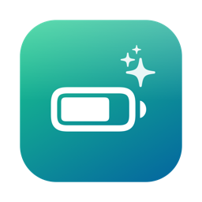
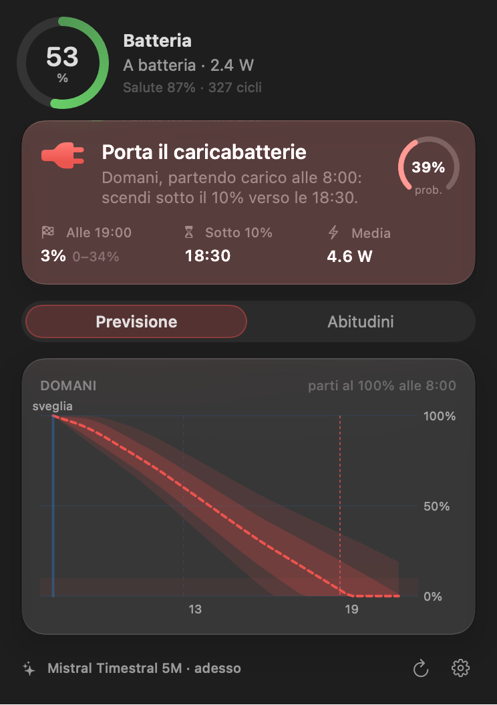
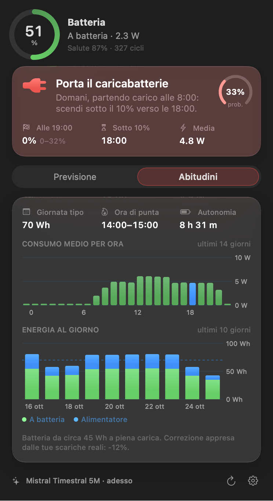
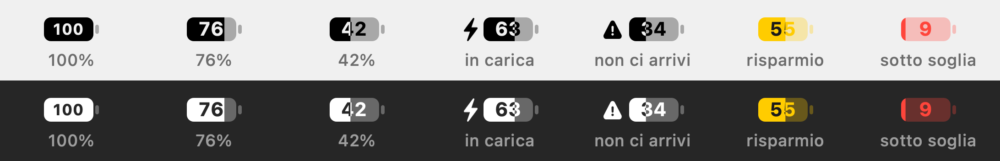

<p align="center">
  
</p>

<h1 align="center">BatteryOracle</h1>

<p align="center">
  <b>Ti dice al mattino se oggi devi portarti il caricabatterie.</b><br>
  App per la barra dei menu di macOS che impara come usi il Mac e prevede la batteria con
  <a href="https://github.com/mistralai/timestral">Mistral Timestral</a>, in locale.
</p>

<p align="center">
  
  &nbsp;
  
</p>

<p align="center">
  
</p>

> *English:* BatteryOracle is a macOS menu bar app that learns how much power your Mac draws through the day and uses Mistral's Timestral time-series model, running locally on the CPU, to tell you whether the battery will last until the evening, with a probability, not a guess.

---

## Cosa fa

- **Verdetto con probabilità**: *Arrivi a fine giornata*, *Ce la fai, ma al limite* o *Porta il caricabatterie*, con la probabilità di arrivare all'orario scelto sopra la soglia minima.
- **Grafico delle prossime ore**: livello reale delle ultime 12 ore, previsione mediana e due fasce di incertezza (80% e 50%), con passaggio del mouse per leggere ogni punto.
- **Pianifica domani**: dopo la fine giornata la previsione passa a domani, partendo carico all'ora del risveglio.
- **Abitudini**: consumo medio ora per ora, energia al giorno divisa tra batteria e alimentatore, ora di punta, autonomia tipica.
- **Avvisi**: una notifica al mattino se la giornata sarà al limite, e un'altra se durante il giorno il ritmo non basta. Arrivano solo quando lo schermo è acceso: se scattano a Mac chiuso, aspettano che lo riapri.
- **Salute batteria**: capacità residua, cicli e temperatura direttamente nel popover.
- **Batteria nella barra dei menu in stile Apple**, con la percentuale dentro per occupare poco spazio. Diventa **gialla** con il risparmio energetico attivo e **rossa** sotto la soglia scelta; in carica compare il fulmine.
- **Interruttore del risparmio energetico** nel popover (vedi sotto).
- Avvio al login, soglia e orari configurabili, percentuale dentro la batteria attivabile dalle impostazioni.

## Come funziona

```
 IOKit (AppleSmartBattery)          ogni 2 minuti: livello, alimentatore, consumo del sistema (W)
          │                         + eventi di sospensione/risveglio
          ▼
 history.csv  ─────────────▶  serie di potenza a 15 minuti (ultimi 30 giorni)
                                         │
                                         ▼
                Mistral Timestral  ◀── covariate note: ora del giorno, giorno della settimana, weekend
                (processo Python breve)     covariata passata: alimentatore collegato
                                         │
                                         ▼  21 quantili di consumo per le prossime 26 ore
                      simulazione della scarica  →  livello, orario della soglia, probabilità
```

La scelta chiave è **prevedere il consumo, non la percentuale**. La percentuale dipende da quando attacchi il cavo, che è imprevedibile. Il consumo dipende da come lavori, che è molto regolare. Il Mac misura il consumo del sistema anche quando è collegato all'alimentatore (`PowerTelemetryData.SystemLoad`), quindi ogni minuto di utilizzo diventa un dato utile.

Da lì la batteria si simula: *livello = livello attuale − consumo previsto ÷ capacità in Wh*. Ogni quantile di consumo dà un percorso di livello, e la probabilità di arrivare a fine giornata è il quantile che arriva esattamente alla soglia. Le fasce sono volutamente prudenti, perché si assume che le ore più pesanti si sommino tra loro.

Due costanti si imparano dai tuoi dati:
- **consumo in sospensione**, misurato sul calo della batteria durante le notti scollegate;
- **calibrazione**, cioè il rapporto tra il calo reale della batteria e il consumo integrato. Corregge la stima dei Wh e le differenze di misura.

Finché il motore Timestral non è installato, l'app usa un **profilo statistico**: i quantili del consumo nella stessa fascia oraria nei giorni simili delle ultime due settimane. Così funziona subito.

## Efficienza

Misurato sull'app installata, a riposo (macOS 27, Apple Silicon):

| | |
|---|---|
| App a riposo | **0% CPU, 0 risvegli, ~16 MB di memoria** (`footprint`, SwiftUI + Swift Charts) |
| Campionamento | lettura diretta di IOKit ogni 2 minuti (tolleranza di 60 s, così il sistema la unisce ad altri risvegli), nessun processo esterno |
| Mac chiuso | **nessuna attività a schermo spento**: i risvegli parziali del Mac (Power Nap, controlli di Mail e iCloud: migliaia al giorno) vengono ignorati, e la notte conta come un'unica sospensione nello storico |
| Cambio alimentatore | notifica di sistema immediata, senza polling |
| Previsione | ~2 s ogni ora a batteria, ogni 3 ore all'alimentatore (l'esito si aggiorna comunque con il livello reale a ogni lettura); il processo Python termina subito, quindi tra una previsione e l'altra **non resta niente in memoria** |
| Timestral 5M | ~10 ms di inferenza, il resto è l'avvio di PyTorch; priorità *utility*, 2 thread |
| Storico | CSV in append, ~1 MB per 30 giorni, compattato all'avvio |

## Risparmio energetico senza password

Nel popover c'è un interruttore che attiva e disattiva la modalità risparmio energetico di macOS. Non esiste un'API pubblica per farlo, quindi l'app esegue `pmset`, che richiede i permessi di root. Per non digitare la password a ogni clic, installa una volta una regola `sudoers` limitata a quei due comandi esatti:

```sh
t=$(mktemp) && echo "$(whoami) ALL=(root) NOPASSWD: /usr/bin/pmset -a lowpowermode 0, /usr/bin/pmset -a lowpowermode 1" > $t \
  && sudo visudo -cf $t && sudo install -m 440 -o root -g wheel $t /etc/sudoers.d/batteryoracle; rm -f $t
```

Per rimuoverla: `sudo rm /etc/sudoers.d/batteryoracle`.

L'app prova, in ordine: `sudo -n pmset` (silenzioso, con la regola), due comandi rapidi chiamati `BatteryOracle risparmio on` e `BatteryOracle risparmio off` (azione *Imposta modalità risparmio energetico*, anche questi senza password) e infine `pmset` con la richiesta di password di sistema.

## Installazione

Requisiti: macOS 14 o successivo, un Mac con batteria, gli strumenti da riga di comando di Xcode (`xcode-select --install`). Per il motore servono anche Python 3.10–3.13 (`brew install python@3.13`).

```bash
git clone https://github.com/migalella/BatteryOracle.git
cd BatteryOracle
make install      # compila BatteryOracle.app, la copia in /Applications e la avvia
```

Poi installa il motore dalle impostazioni dell'app (**Installa Timestral**) oppure da terminale:

```bash
make engine
```

Il motore va in `~/Library/Application Support/BatteryOracle/engine`: un ambiente Python privato con PyTorch e circa 1 GB in tutto. I pesi di Timestral 5M pesano 21 MB. Dalle impostazioni puoi passare ai modelli 28M o 123M.

> L'app è firmata ad-hoc. Al primo avvio, se macOS la blocca, aprila con clic destro → **Apri**.

### Provarla subito

```bash
make demo
```

Carica due settimane di utilizzo simulato e mostra il popover in una finestra.

## Privacy

Tutto resta sul Mac. Lo storico è in `~/Library/Application Support/BatteryOracle/history.csv` e il modello gira in locale. L'unico accesso alla rete è il download una tantum di PyTorch e dei pesi da Hugging Face durante l'installazione del motore.

## Struttura

```
Sources/BatteryOracle/
  Battery.swift          lettura IOKit e notifiche del cambio di alimentazione
  History.swift          log, serie a 15 minuti, sospensione, calibrazione, abitudini, demo
  Forecaster.swift       motore Timestral, profilo statistico, simulazione della scarica
  AppModel.swift         campionamento, pianificazione, notifiche, risparmio energetico, impostazioni
  Views/                 popover, grafici, abitudini, impostazioni
  Views/MenuBarBattery   l'icona della barra dei menu, disegnata a mano (percentuale dentro, colori)
engine/forecast.py       richiesta JSON su stdin → quantili di consumo su stdout
scripts/                 build della .app, icona, installazione del motore, render di docs/menubar.png
```

## Limiti noti

- La capacità in Wh è stimata da mAh e tensione nominale delle celle; la calibrazione ne corregge l'errore dopo qualche scarica.
- La telemetria `SystemLoad` è completa sui Mac Apple Silicon. Sui modelli Intel l'app usa la corrente della batteria, che è nota solo quando il Mac è scollegato.
- A schermo spento (coperchio chiuso, o Mac fermo all'alimentatore con lo schermo inattivo) l'app non registra dati: i risvegli parziali non si distinguono dall'inattività, e registrarli falserebbe il consumo in sospensione. In modalità clamshell con monitor esterno funziona normalmente.
- Il risparmio energetico richiede la regola `sudoers` per non chiedere la password (vedi sopra).
- Le notifiche e l'avvio al login richiedono l'app installata come bundle (`make install`), non `swift run`.
- Servono qualche ora di dati per la prima previsione e qualche giorno perché diventi affidabile.

## Crediti

- [Mistral Timestral](https://github.com/mistralai/timestral): codice di inferenza Apache-2.0, pesi con licenza Modified MIT di Mistral AI.
- Idea ispirata a un reel di [@mattbonfanti](https://www.instagram.com/mattbonfanti/).

Codice rilasciato con [licenza MIT](LICENSE).
